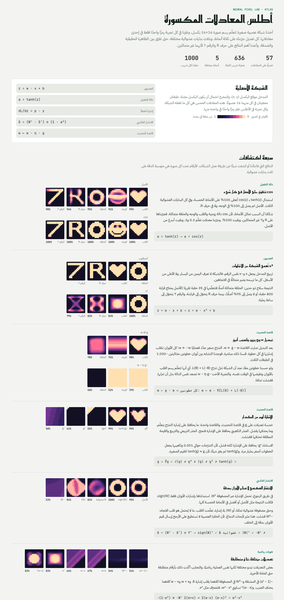

# Neural Pixel Lab · مختبر البكسل العصبي

شبكة عصبية صغيرة تتعلّم رسم صورة بكسل 16×16، ثم نغيّر رمزًا واحدًا في إحدى معادلاتها ونرى ماذا يحدث.

A tiny neural network learns to draw a 16×16 pixel image. We then change **one symbol** in one of its formulas and watch what happens.



## المحتوى · Contents

| المسار | ما فيه |
|---|---|
| `media/neural-pixel-lab.mp4` | الفيديو (2:20): 10 تعديلات بتعليق إنجليزي وترجمة عربية |
| `atlas/index.html` | أطلس تفاعلي لـ 57 تعديلًا، مع صورة ونتيجة وتفسير لكل تجربة |
| `lab/index.html` | صفحة تفاعلية تدرّب 12 شبكة في المتصفح مباشرة وتقارنها |
| `experiments/` | محرك التجارب، والتشغيل المتوازي، والنتائج الخام (JSON) |
| `film/` | خط إنتاج الفيديو: الرسم والصوت والتعليق |

افتح `atlas/index.html` أو `lab/index.html` في المتصفح مباشرة، فلا يحتاجان خادمًا.

## الشبكة الأصلية · The original network

```
Neuron          z  = w · x + b
Activation      a  = tanh(z)
Error signal    dL/dz = p − y
Backprop        δ  = (Wᵀ · δ′) ⊙ (1 − a²)
Update rule     w ← w − η · g
```

بنية الشبكة 2 → 16 → 16 → 1، والمدخل موقع البكسل (x, y)، والمخرج احتمال أن يكون البكسل مضاءً.

## التجربة · The experiment

- **57** تعديلًا بالرمز الواحد في 6 أماكن: قاعدة التحديث، والعصبون، ودالة التفعيل، ومشتقة الانتشار العكسي، ومصفوفة الانتشار العكسي، وإشارة الخطأ.
- كل تعديل على 3 أنماط (قلب، وجه، حلقة) × 3 بدايات عشوائية × 1000 حقبة.
- إعادة أهم النتائج على أنماط غير متماثلة (حرف R والرقم 7) وبمعدلات تعلّم أخرى.
- المجموع: **636** عملية تدريب كاملة.

## أبرز الاكتشافات · Key findings

| التعديل | النتيجة | السبب |
|---|---|---|
| `tanh(z) → cos(z)` | 100% على الأنماط الخمسة وكل البدايات، أفضل من الأصل | المرجّح: كل عصبون يصير موجة عبر الصورة، والتدرّج لا يتشبع |
| `x → x²` | الحلقة 100% في ~35 حقبة؛ القلب عالق عند 83%؛ R يصير فراشة | مثبت: x² لا تفرّق بين x و−x، فكل ما ترسمه الشبكة متماثل |
| `w ← g − η·w` (تبديل w وg) | يتعلّم القلب 98% | مثبت: الأوزان تنقلب كل خطوة، وكل خطوتين ينزل تدرّج L(θ)+L(−θ) |
| `−w − η·g` | يفشل | أخت التجربة السابقة لكنها تصعد نفس الدالة |
| `g → ∛g` ✓ / `√|g|`, `g²`, `|g|` ✗ | ما يحافظ على إشارة التدرّج يتعلّم | الإشارة تحدد الاتجاه، والمقدار يمكن تشويهه |
| `g → g³` | يفشل | التدرّجات ~0.001، وتكعيبها يصغّر الخطوات مليار مرة |
| `Wᵀ → sign(W)ᵀ` في الانتشار العكسي | مثل الأصل أو أفضل في الأنماط الخمسة | الانتشار العكسي لا يحتاج قيم الأوزان بدقة (sign symmetry) |
| `Wᵀ → B` عشوائية | يتعلّم القلب 95–97% | محاذاة التغذية الراجعة (feedback alignment) |
| `−(1−a²)` و `−Wᵀ` | أرقام متطابقة حرفيًا | هوية رياضية: الاثنان يقلبان إشارة δ |

التفاصيل الكاملة والتفسير لكل تجربة في `atlas/index.html`.

## التشغيل · Running it

المتطلبات: Node.js 18+، وPython 3 مع `numpy` و`scipy` و`soundfile`، وffmpeg، وPlaywright مع Chromium لإنتاج الفيديو فقط.

```bash
cd experiments
node sweep.js                      # 522 runs on heart/smile/ring → sweep.json (~7 min on 4 cores)
PATS=R,seven ONLY=base,a_cos,n_xsq OUT=sweep_asym.json node sweep.js
node analyze.js                    # text summary + ASCII pixel grids
node build_data.js                 # → atlas_data.json for the atlas page
```

إنتاج الفيديو:

```bash
cd film
node pre2.js                       # precompute all training runs → data.json
pip install kokoro-onnx soundfile  # narration voice (model files from the kokoro-onnx GitHub releases)
python3 tts.py <kokoro-model-dir> . bm_george
node events.js && python3 audio.py .
node video.js                      # renders 1920×1080 frames → video_only.mp4
ffmpeg -i video_only.mp4 -i audio/mix.wav -c:v copy -c:a aac -shortest out.mp4
```

## الصوت · Audio

- التعليق مولّد محليًا بنموذج [Kokoro](https://github.com/thewh1teagle/kokoro-onnx) مفتوح المصدر.
- الموسيقى والمؤثرات مركّبة برمجيًا في `film/audio.py`، بدون عينات خارجية.

## الحدود · Limitations

- الشبكة صغيرة جدًا والصور 16×16 فقط، فما ينجح هنا قد لا ينجح في شبكة كبيرة.
- معدل التعلّم واحد (η = 1) لمعظم التعديلات، وبعض التعديلات الفاشلة قد تنجح بمعدل آخر.
- ثلاث بدايات عشوائية لكل تجربة، فلا نعتبر فرقًا أقل من 2 إلى 3 نقاط حقيقيًا.
