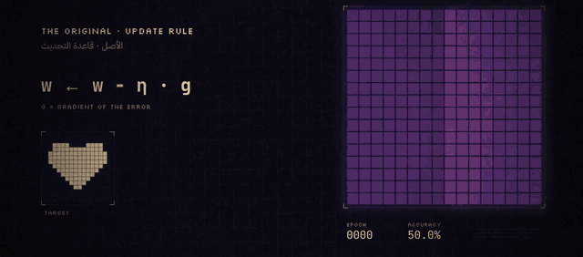
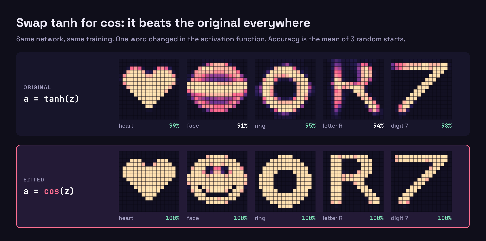
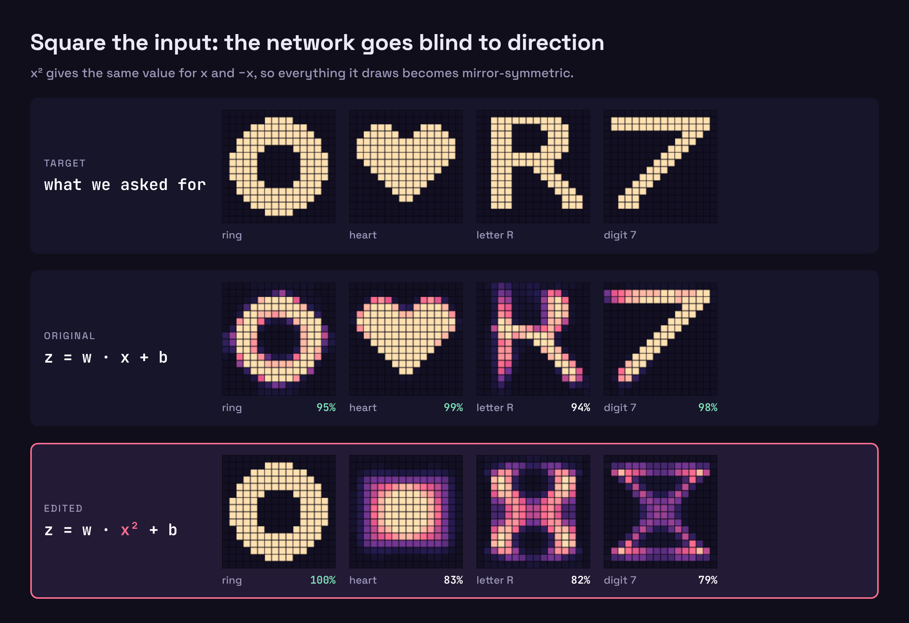
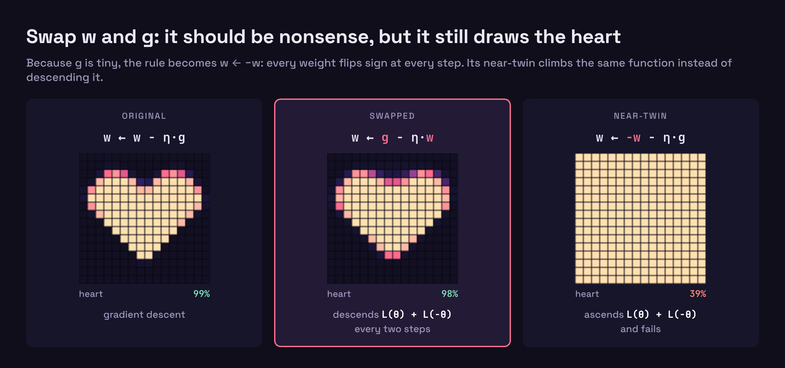
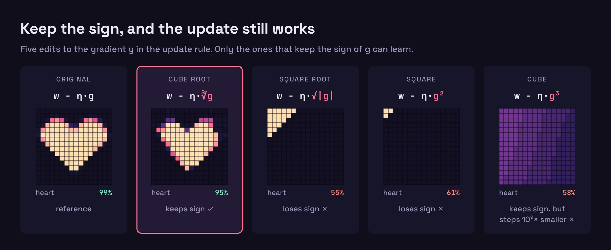
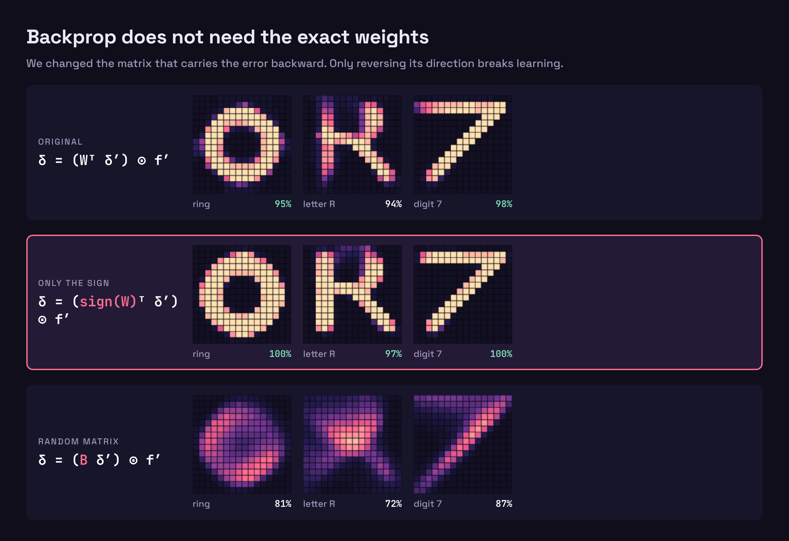

# Neural Pixel Lab

**What happens to a neural network when you change one symbol in its math?**

A tiny network learns to draw a 16×16 pixel image. We then edit a single symbol in one of its formulas (a sign, a square, a root, two swapped variables) and watch what it draws instead.

[](media/neural-pixel-lab.mp4)

**[▶ Watch the full film (2:20)](media/neural-pixel-lab.mp4)**: ten one-symbol edits, with English narration and Arabic subtitles.

---

## The most surprising results

### 1. Swapping `tanh` for `cos` beats the original everywhere



`cos` reached 100% on all five patterns, with every random start. The original never reached 100% on the face or the letter R.

We first suspected this was because the heart, face and ring are symmetric, and `cos` is an even function. So we re-tested on R and 7, which are not symmetric: still 100%. At learning rates of 0.3 and 3 it also generally reached 95% sooner than the original.

Our best explanation: each first-layer neuron becomes a wave across the image (much like a Fourier feature), and the gradient of `cos` does not vanish for large inputs the way the gradient of `tanh` does.

### 2. Squaring the input makes the network blind to direction



`x²` gives the same value for `x` and `−x`, so the network cannot tell left from right, or top from bottom. Everything it draws becomes mirror-symmetric in both directions.

That is a disaster for asymmetric shapes: R turns into a butterfly and 7 into an hourglass. It is a gift for the ring, which is already symmetric: learned to 100% in about 35 epochs, while the original needs around 800 or never gets there. The formula decides in advance which shapes the network can see.

### 3. Swapping `w` and `g` should be nonsense, but it still draws the heart



The gradient `g` is tiny compared to the weights, so `w ← g − η·w` behaves like `w ← −w`: every weight flips sign at every step. We measured it directly, and the similarity between consecutive steps is exactly −1.000 in all three layers.

Taken two steps at a time, the update works out to gradient descent on `L(θ) + L(−θ)`. The network learns a solution that draws the heart with its weights **and** with their negation.

Its near-twin `w ← −w − η·g` also flips every step, but it climbs that same function instead of descending it, and fails completely. One sign apart, opposite outcomes.

### 4. The update survives any distortion that keeps the sign



Across five edits to `g` in the update rule, the rule is simple: keep the sign of the gradient and learning works; lose it and learning fails. `∛g` keeps the sign and learns. `√|g|` and `g²` throw it away, so every step points the same direction and the image goes dark.

The exception proves the point from the other side: `g³` keeps the sign but turns gradients of about 0.001 into 0.000000001, so the network is effectively frozen.

### 5. Backpropagation does not need the exact weights



On the way back, the error travels through `Wᵀ`. Replacing it with only the **signs** of the weights matched or beat the original on every pattern. Even a completely **random** fixed matrix still learns the heart (95–97%), though it falls behind on harder shapes. This is a known effect called *feedback alignment*. The one thing backprop cannot survive is reversing direction (`−Wᵀ`).

This matters beyond toy networks: real neurons almost certainly cannot send exact weight values backward, and these results suggest they may not need to.

---

## The experiment

The original network is 2 → 16 → 16 → 1. The input is a pixel position `(x, y)`, and the output is the probability that the pixel is lit. Five formulas define everything it does:

```
Neuron          z  = w · x + b
Activation      a  = tanh(z)
Error signal    dL/dz = p − y
Backprop        δ  = (Wᵀ · δ′) ⊙ (1 − a²)
Update rule     w ← w − η · g
```

- **57** one-symbol edits across those five places.
- Each edit trained on 3 patterns (heart, face, ring) × 3 random starts × 1000 epochs.
- The key results re-tested on asymmetric shapes (letter R, digit 7) and at other learning rates.
- **636** full training runs in total.

### Reading the failures

On the heart, 39% of pixels are lit and 61% are dark. An accuracy of exactly **39%** means the network lit everything; exactly **61%** means it drew nothing. Many failed edits land on one of these two numbers.

### All 57 experiments

Open [`atlas/index.html`](atlas/index.html) in a browser for every experiment: the image it produced on each pattern, its accuracy, and an explanation of why it happened. The atlas is written in Arabic.

[`lab/index.html`](lab/index.html) trains 12 network variants live in your browser so you can compare them, or draw your own target pattern.

## Running the experiments

Requires Node.js 18+.

```bash
cd experiments
node sweep.js        # 522 runs on heart/face/ring → sweep.json (~7 min on 4 cores)
node analyze.js      # text summary with ASCII pixel grids
```

Re-run selected edits on the asymmetric patterns:

```bash
PATS=R,seven ONLY=base,a_cos,n_xsq,b_signW OUT=sweep_asym.json node sweep.js
IN=sweep_asym.json PATS=R,seven node analyze.js
```

Each edit is one line in `experiments/sweep.js`, so adding your own takes a minute.

## Limitations

- The network is tiny and the images are 16×16. What works here may not hold for large networks, and the reverse.
- Most edits use a single learning rate (η = 1). Some failures might succeed at another rate.
- Three random starts per edit catch obvious flukes, but differences under 2–3 points should not be read as real.
- Some explanations above are proven (the swap, the symmetry); others are our best interpretation, and the text says which.
